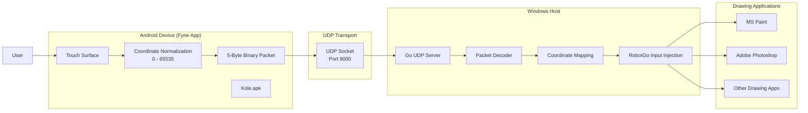

# Kole

Kole is a low-latency virtual graphics tablet built entirely with Go.

The system transforms an Android smartphone into a wireless drawing surface that controls the cursor and drawing operations on a Windows computer. Touch events are captured on the mobile device, transmitted through a custom UDP protocol, and converted into native mouse input events on the desktop.

---

## Features

- Android-powered virtual drawing tablet
- Real-time touch-to-cursor mapping
- Low-latency UDP communication
- Custom 5-byte binary protocol
- Cross-device interaction
- Resolution-independent coordinate mapping
- Native Windows input injection
- Compatible with MS Paint and Adobe Photoshop

---

## Technology Stack

### Mobile Client

- Go
- Fyne
- Android NDK
- Cgo

### Desktop Server

- Go
- RobotGo
- Win32 APIs

### Networking

- UDP
- Custom Binary Protocol
- Big-Endian Encoding

---

## Project Structure

```text
KOLE
│
├── cmd
│   ├── client
│   │   ├── FyneApp.toml
│   │   ├── Icon.png
│   │   ├── Kole.apk
│   │   └── main.go
│   │
│   └── server
│       └── main.go
│
├── go.mod
├── go.sum
└── README.md
```

---

## How It Works

```text
Android Phone
      │
      ▼
Touch Input Capture
      │
      ▼
Coordinate Normalization
      │
      ▼
5-Byte Binary Packet
      │
      ▼
UDP Transmission
      │
      ▼
Windows UDP Server
      │
      ▼
Coordinate Mapping
      │
      ▼
Input Injection
      │
      ▼
MS Paint / Photoshop
```

---

## Binary Protocol

Kole uses a highly compact binary protocol optimized for low-latency communication.

| Bytes | Field | Type |
|---------|---------|---------|
| 0 | Event Type | uint8 |
| 1-2 | X Coordinate | uint16 |
| 3-4 | Y Coordinate | uint16 |

### Event Types

```text
0x01 → Touch Down / Move
0x00 → Touch Release
```

Total Packet Size:

```text
5 Bytes
```

---

## Coordinate Normalization

Mobile coordinates are normalized into a universal range:

```text
Normalized = Position / ScreenSize × 65535
```

Benefits:

- Resolution independent
- Works across different devices
- Accurate cursor positioning

---

## Screenshots

### Android Application

Add Screenshot Here

### Desktop Drawing Session

Add Screenshot Here

### MS Paint Integration

Add Screenshot Here

---

## Performance Highlights

- Custom 5-byte binary protocol
- UDP transport layer
- Resolution-independent mapping
- Low-latency cursor updates
- Minimal serialization overhead

---

## Engineering Challenges Solved

### Network Latency

Implemented a compact UDP protocol to reduce transmission overhead and improve responsiveness.

### Resolution Differences

Designed a coordinate normalization algorithm to support various mobile and desktop screen sizes.

### Input Accuracy

Mapped normalized coordinates to the Windows display grid and injected native mouse events using RobotGo.

### Real-Time Drawing

Maintained continuous drawing sessions through direct mouse state control.

---

## Learning Outcomes

This project helped me gain practical experience with:

- Systems Programming
- Networking
- UDP Socket Programming
- Binary Protocol Design
- Coordinate Transformations
- Cross-Platform Development
- Android Development with Go
- Performance Optimization

---

## Architecture Diagram

## System Architecture




## License

MIT License
